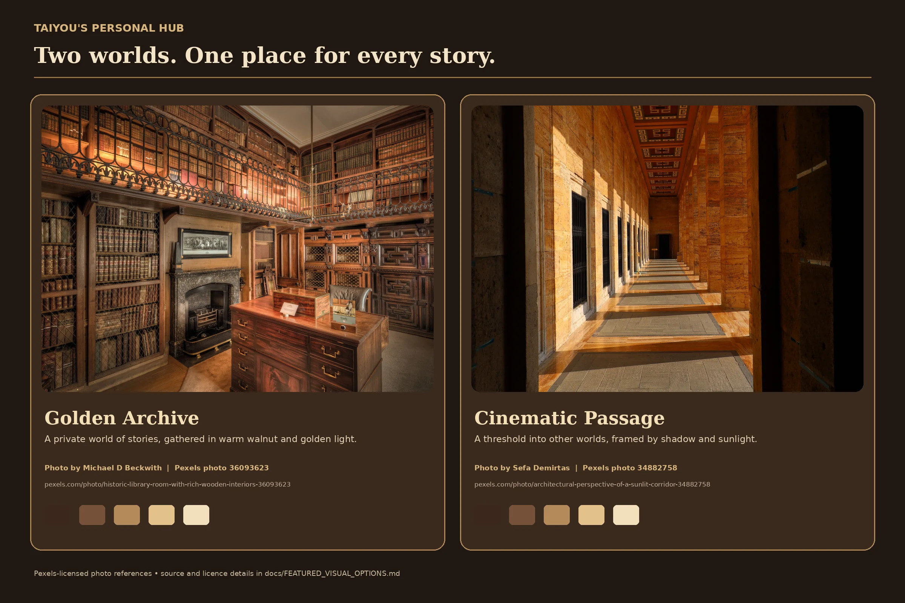

# Featured visual exploration: Golden Archive and Cinematic Passage

**Status: owner-approved for a coded prototype; neither option is yet the production design.**  
**Last reviewed:** 21 November 2026.

This moodboard is a combined, credited design reference showing the two photographic concepts side by side. It is stored at 2400 × 1600 pixels (343,708 bytes). The original stock photographs are **not** committed as separate downloadable files because the Pexels licence prohibits standalone redistribution. Their original source pages, photographer credits, dimensions and licence are recorded below so a future implementation can obtain the selected photograph directly from its source.

## Why this exploration exists

The owner is no longer committed to a Japanese/sakura theme. The brown, pale-gold and glowing-gold visual language from the supplied “Still Waters” video is appealing, but the crane itself is not a requirement. The owner liked both the **Golden Archive** and **Cinematic Passage** concepts and proposed a composition with one striking featured visual on the left and four library tiles on the right.

The aim is a premium, personal, cinematic gateway: strong photography, restrained typography, warm material colours, clear hierarchy and four immediately recognisable destinations. Avoid making every component decorative.

## Option A: Golden Archive

- **Photographer:** Michael D Beckwith.
- **Source:** [Historic Library Room with Rich Wooden Interiors, Pexels photo 36093623](https://www.pexels.com/photo/historic-library-room-with-rich-wooden-interiors-36093623/).
- **Pexels description:** a historic library in Scotland with extensive wooden bookshelves.
- **Original dimensions:** 8687 × 5791 (landscape, approximately 3:2).
- **Visual character:** dark walnut, antique books, warm highlights and substantial depth.
- **Why it may work:** directly connects to a personal collection of stories without being tied to one country, genre or medium. It is the more literal and welcoming option.
- **Risk to test:** the shelves and furniture are detailed. Keep copy minimal and test the crop so the image remains a focal point rather than busy wallpaper.

## Option B: Cinematic Passage

- **Photographer:** Sefa Demirtaş.
- **Source:** [Architectural Perspective of a Sunlit Corridor, Pexels photo 34882758](https://www.pexels.com/photo/architectural-perspective-of-a-sunlit-corridor-34882758/).
- **Pexels description:** golden sunlight creates dramatic shadows in an ornate architectural corridor.
- **Original dimensions:** 4160 × 6240 (portrait, 2:3).
- **Visual character:** deep bronze/brown framing, a warm sunlit vanishing point, repeated arches and strong architectural perspective.
- **Why it may work:** suggests entering another world. It is less literal than a library and gives the Hub a distinctive cinematic identity.
- **Risk to test:** its portrait source needs careful responsive cropping in a wide left-hand feature panel. Preserve the vanishing point and avoid crushing the shadows.

## Image rights and future use

Both source pages identify the photographs as free under the [Pexels licence](https://www.pexels.com/license/). The licence permits free website use and modification; attribution is not required but is appreciated. It prohibits distributing or selling the photographs as standalone files, so this public repository stores a combined moodboard rather than separate raw stock images. The photographer and source-page credits are retained here.

Pexels also notes that some images can involve additional property, trademark, privacy or other rights. Its licence is not a blanket release for every depicted building or mark. Recheck any such rights before using the corridor/library photograph in a public or commercial product.

If either image is selected for the actual Hub, obtain it directly from its original Pexels page, use it as part of the designed website (not as a standalone stock file), preserve its provenance, review the final crop, verify the strict self-only CSP and test production asset size. Do not hotlink Pexels or commit the raw stock photo separately into this public repository.

## Shared Taiyou Sun identity

The owner also approved using the same Sun mark already used by the Novel and Manga applications, replacing the separate Hub-only logo during the future redesign. The exact shared files have been copied byte-for-byte into this repository for reference:

| Variant | Local reference | Source Git blob SHA-1 (byte-identical) |
| --- | --- | --- |
| Light | `docs/assets/sun-light.webp` | `d292f5b3f8306925b93f1db4b7bee77324072a01` |
| Dark | `docs/assets/sun-dark.webp` | `565156eb5da784cdf1c4117a5d300b05dae71d35` |

Both source repositories use these same binary assets. The Novel source files are `public/branding/sun-light.webp` and `public/branding/sun-dark.webp`; Manga uses the same files. The reference components are `src/components/BrandMark.tsx` and `src/components/MangaBrandMark.tsx`. The Hub has **not** switched to these files yet: its currently deployed header and favicon still use `hub-sun-logo.svg` and `hub-sun.svg`. When implementing the new header, inspect both logo variants against all six Hub themes and choose the correct light/dark mapping rather than copying one sibling's theme mapping blindly.

| Shared light mark | Shared dark mark |
| --- | --- |
|  |  |

## Proposed code-built composition

The next prototype should compare both photographs using the same layout and the same four existing approved media illustrations, so the image choice is the meaningful variable.

- **Desktop concept:** one featured visual on the left, approximately 52–58% of the content width; four compact media tiles on the right in a 2 × 2 grid.
- **Header:** use the shared Sun mark for brand consistency; remove the redundant “MY MEDIA GATEWAY” subtitle. Keep the theme selector accessible and visually quiet.
- **Copy:** “A Place for Every Story.” is only a candidate headline, not final approved copy. Do not add a large welcome paragraph or motto by default.
- **Tiles:** retain the exact four owner-approved text-free WebP illustrations. Prefer a clean image-and-title treatment; avoid stacking descriptions, status pills, large CTA buttons and decorative overlays unless screenshot evidence shows they are needed.
- **Palette:** deep walnut/brown, pale gold and a restrained brighter gold accent. Japanese imagery, sakura, Mount Fuji, cranes and other cultural motifs are optional, not requirements.
- **Typography:** a refined editorial serif for the main brand/headline and a highly legible sans-serif for controls are candidates. Current CSP permits only self-hosted fonts. If a web font is selected, self-host a properly licensed file and keep the strict CSP. Do not silently introduce Google Fonts or another runtime dependency.
- **Responsive behaviour:** prototype tablet and mobile layouts rather than shrinking the desktop split. The image should remain meaningful, the four destinations should remain easy to scan, and there must be no horizontal overflow or loss of keyboard/screen-reader semantics.
- **Themes:** preserve the six existing theme choices and Sepia default unless the owner explicitly changes that requirement. Test light and dark themes, not just one brown mock-up.

The owner has approved building and comparing a coded prototype, **not** a production switch. The selected photo, crop, typeface, copy and final palette remain open.

## Production baseline: do not confuse references with implementation

At the time of this review, canonical `master` and the live Cloudflare Hub are at `09d4673ba01fb21216fcab8eda2fb01f8c4ebfbc`. The production page is still the **hero-free, centred, midsize four-poster scenic gallery** with the sakura/Mount Fuji background, Hub-specific SVG Sun logo, Georgia typography and HTML card captions. The moodboard and shared Sun WebPs are documentation references only; they are not loaded by the app.

## Prototype acceptance checklist

- Compare Golden Archive and Cinematic Passage in the same coded split layout at 1600 × 900, 1366 × 768 and 1280 × 720.
- Inspect desktop image focal point/crop, card balance, header branding, type scale, negative space and footer.
- Test 768px tablet, 390px and 320px mobile, plus 200% zoom and keyboard navigation.
- Test all six themes, contrast, focus, reduced motion and screen-reader heading/card order.
- Preserve the current approved card artwork byte-for-byte and the Novel/Manga destinations.
- Keep all runtime images/fonts self-hosted and within the current strict CSP.
- Include actual browser screenshots in the PR; a static mock-up or generated whole-page picture is not implementation.
- Do not deploy the redesign until the owner has reviewed the coded result.
