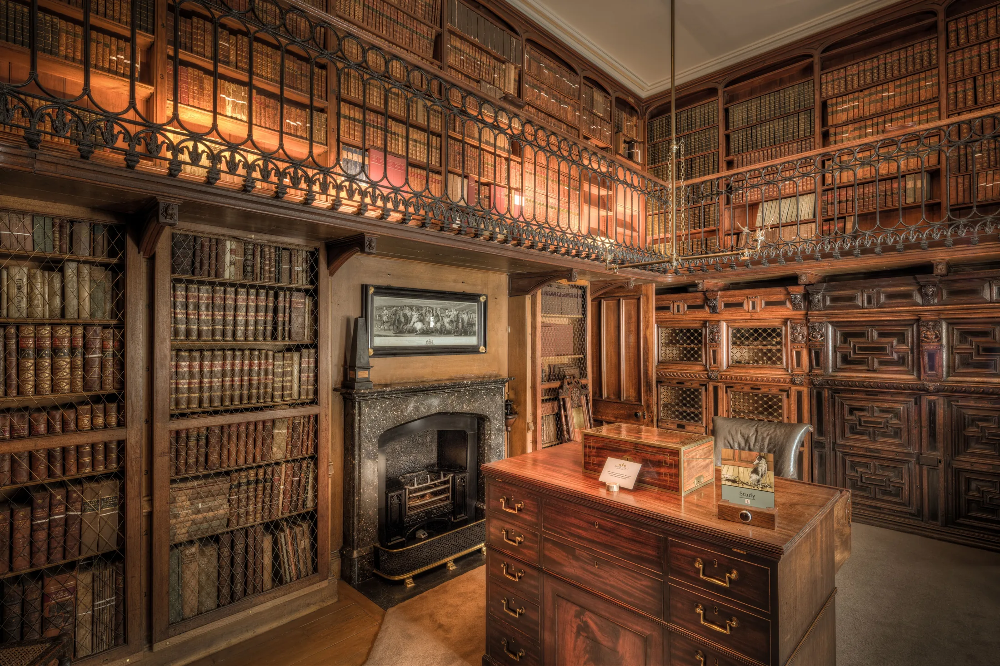
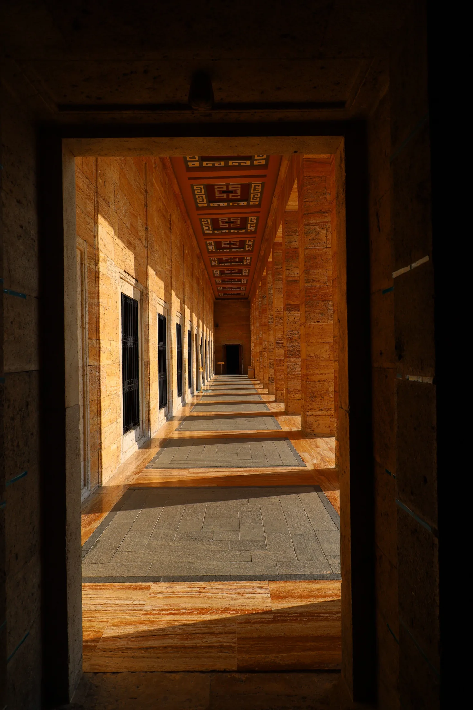

# Featured visual exploration: Golden Archive and Cinematic Passage

**Status: owner-approved for a coded prototype; neither option is yet the production design.**  
**Last reviewed:** 21 November 2026.

This document records the next visual direction without rewriting the current production baseline. The two photographs and shared Sun marks are local reference assets in `docs/assets/`; they are not imported by the Hub runtime and are not copied into `apps/hub/dist`.

## Why this exploration exists

The owner is no longer committed to a Japanese/sakura theme. The brown, pale-gold and glowing-gold visual language from the supplied “Still Waters” video is appealing, but the crane itself is not a requirement. The owner liked both the **Golden Archive** and **Cinematic Passage** concepts and proposed a composition with one striking featured visual on the left and four library tiles on the right.

The aim is a premium, personal, cinematic gateway: strong photography, restrained typography, warm material colours, clear hierarchy and four immediately recognisable destinations. Avoid the current tendency to make every component decorative.

## Option A: Golden Archive

- **Photographer:** Michael D Beckwith.
- **Source:** [Historic Library Room with Rich Wooden Interiors, Pexels photo 36093623](https://www.pexels.com/photo/historic-library-room-with-rich-wooden-interiors-36093623/).
- **Original dimensions:** 8687 × 5791 (landscape, approximately 3:2).
- **Repository copy:** `docs/assets/golden-archive.webp`, 2200 × 1467, 653,422 bytes.
- **Visual character:** deep walnut, antique books, brass-like warm highlights, a real historic room and substantial depth.
- **Why it may work:** it connects naturally to a personal collection of stories without being tied to one country, genre or medium. It is the more literal and welcoming of the two options.
- **Risk to test:** the shelves and furniture are detailed. Keep copy minimal and test the crop so the image remains a focal point rather than a busy wallpaper.

## Option B: Cinematic Passage

- **Photographer:** Sefa Demirtaş.
- **Source:** [Architectural Perspective of a Sunlit Corridor, Pexels photo 34882758](https://www.pexels.com/photo/architectural-perspective-of-a-sunlit-corridor-34882758/).
- **Original dimensions:** 4160 × 6240 (portrait, 2:3).
- **Repository copy:** `docs/assets/cinematic-passage.webp`, 1467 × 2200, 264,072 bytes.
- **Visual character:** dark bronze/brown framing, a warm sunlit vanishing point, repeated arches and strong architectural perspective.
- **Why it may work:** it suggests entering another world. It is less literal than a library and gives the Hub a distinctive cinematic identity.
- **Risk to test:** its portrait source needs careful responsive cropping in a wide left-hand feature panel. Preserve the vanishing point and avoid crushing the shadows.

## Image rights and hosting

Both source pages identify the photographs as free under the [Pexels licence](https://www.pexels.com/license/). The licence states that photos may be used and modified for free, attribution is not required (but is appreciated), and standalone redistribution/resale as stock is not allowed. The repository keeps the photographer and source-page credits above.

The committed WebP files are optimised local **design references**, not externally hotlinked runtime images. If either is selected for the actual Hub, copy the reviewed local asset into the app's public asset tree, retain this provenance, review the final crop, verify the strict self-only CSP, and test production asset size. Do not add a runtime request to Pexels or any other stock-photo host.

## Shared Taiyou Sun identity

The owner also approved using the same Sun mark already used by the Novel and Manga applications, replacing the separate Hub-only logo during the future redesign. The exact shared files have been copied byte-for-byte into this repository for reference:

| Variant | Local reference | Source SHA-256 |
| --- | --- | --- |
| Light | `docs/assets/sun-light.webp` | `d292f5b3f8306925b93f1db4b7bee77324072a01` |
| Dark | `docs/assets/sun-dark.webp` | `565156eb5da784cdf1c4117a5d300b05dae71d35` |

Both source repositories use these same binary assets. The Novel source is `public/branding/sun-light.webp` and `public/branding/sun-dark.webp`; Manga uses the same files. The reference components are `src/components/BrandMark.tsx` and `src/components/MangaBrandMark.tsx`. The Hub has **not** switched to these files yet: its currently deployed header and favicon still use `hub-sun-logo.svg` and `hub-sun.svg`. When implementing the new header, inspect both logo variants against all six Hub themes and choose the correct light/dark mapping rather than copying one sibling's theme mapping blindly.

| Shared light mark | Shared dark mark |
| --- | --- |
|  |  |

## Proposed code-built composition

The next prototype should compare both photographs using the same layout and the same four existing approved media illustrations, so the image choice is the meaningful variable.

- **Desktop concept:** one featured visual on the left, approximately 52–58% of the content width; four compact media tiles on the right in a 2 × 2 grid.
- **Header:** use the shared Sun mark for brand consistency; remove the redundant “MY MEDIA GATEWAY” subtitle. Keep the theme selector accessible and visually quiet.
- **Copy:** “A Place for Every Story.” is only a candidate headline, not final approved copy. Do not add a large welcome paragraph or motto by default.
- **Tiles:** retain the exact four owner-approved text-free WebP illustrations. Prefer a clean image-and-title treatment; avoid stacking descriptions, status pills, large CTA buttons and decorative overlays unless screenshot evidence shows they are needed.
- **Palette:** deep walnut/brown, pale gold and a restrained brighter gold accent. Japanese imagery, sakura, Mount Fuji, cranes and other cultural motifs are optional, not requirements.
- **Typography:** a refined editorial serif for the main brand/headline and a highly legible sans-serif for controls are candidates. Current CSS uses Georgia; current CSP permits only self-hosted fonts. If a web font is selected, self-host a properly licensed file and keep the strict CSP. Do not silently introduce Google Fonts or another runtime dependency.
- **Responsive behaviour:** prototype the tablet and mobile layouts rather than shrinking the desktop split. The image should remain meaningful, the four destinations should remain easy to scan, and there must be no horizontal overflow or loss of keyboard/screen-reader semantics.
- **Themes:** preserve the six existing theme choices and Sepia default unless the owner explicitly changes that requirement. The new visual direction must be tested in light and dark themes, not just a single brown mock-up.

## Production baseline: do not confuse references with implementation

At the time of this review, canonical `master` and the live Cloudflare Hub are at `09d4673ba01fb21216fcab8eda2fb01f8c4ebfbc`. The production page is still the **hero-free, centred, midsize four-poster scenic gallery** with the sakura/Mount Fuji background, Hub-specific SVG Sun logo, Georgia typography, and HTML card captions. The new photographs and shared Sun WebPs are **not** used by the app. The live release must remain unchanged until a coded prototype has been reviewed and the owner accepts a final direction.

## Prototype acceptance checklist

- Compare Golden Archive and Cinematic Passage in the same coded split layout at 1600 × 900, 1366 × 768 and 1280 × 720.
- Inspect desktop image focal point/crop, card balance, header branding, type scale, negative space and footer.
- Test 768px tablet, 390px and 320px mobile, plus 200% zoom and keyboard navigation.
- Test all six themes, contrast, focus, reduced motion and screen-reader heading/card order.
- Preserve the current approved card artwork byte-for-byte and the Novel/Manga destinations.
- Keep all runtime images/fonts self-hosted and within the current strict CSP.
- Include actual browser screenshots in the PR; a static mock-up or generated whole-page picture is not implementation.
- Do not deploy the redesign until the owner has reviewed the coded result.
